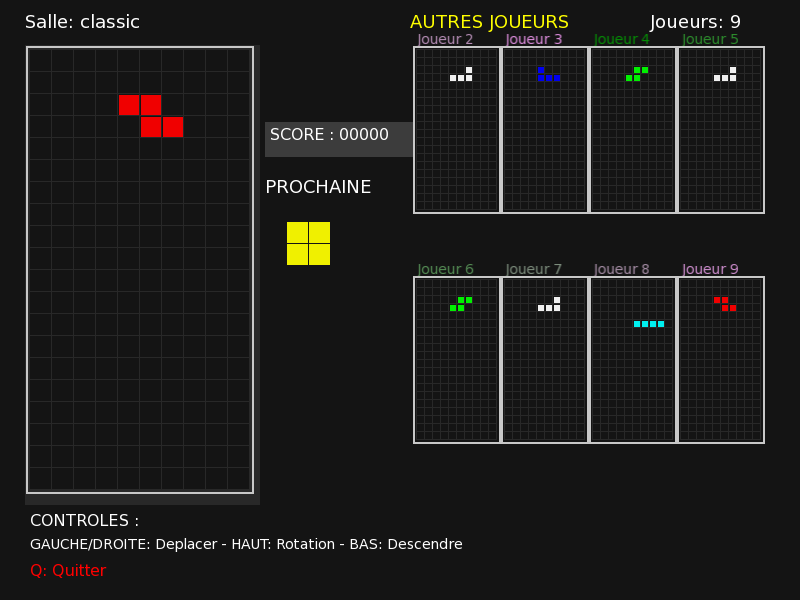

# Tetris Royale

A university team project in C++20, with an SFML interface, offline solo play and client–server multiplayer.



## Game modes

- **Solo / Endless**: play offline.
- **Classic**: 2–9 players, with garbage lines sent to opponents.
- **Duel**: a two-player match.
- **Royal Competition**: 2–9 players, with energy and effects to use against opponents.

The game also includes accounts, friends and saved high scores.

## Build

For Linux, with CMake 3.22+ and a C++20 compiler. CMake downloads SFML 3.0.0 if you don't have SFML 3 installed.

From the repository root on Ubuntu 24.04:

```sh
sudo apt install build-essential cmake git libssl-dev libfreetype-dev \
    libx11-dev libxrandr-dev libxcursor-dev libxi-dev libudev-dev libgl1-mesa-dev
cmake --preset desktop
cmake --build --preset desktop -j 4
```

## Play

Offline solo:

```sh
./build/desktop/src/client/gui/TetrisRoyale --solo
```

For multiplayer, start the server in one terminal and a client in another:

```sh
# Server
./build/desktop/src/server/server

# Client (one per player)
./build/desktop/src/client/gui/TetrisRoyale --server 127.0.0.1
```

Create a different demo account for each player, join the same room, then let the host start the match.

For a LAN game, start the server with `--bind 0.0.0.0` and replace `127.0.0.1` with its LAN IPv4 address. See [network setup and troubleshooting](docs/networking.md).

## Controls

- **Left / Right / Down**: move the piece.
- **Up / X**: rotate clockwise; **Z**: counterclockwise; **C**: 180°.
- **Space**: hard drop.
- **Q**: return to the menu.
- In Royal Competition, click a player's board to choose an effect.

## Tests and documentation

```sh
ctest --preset desktop
```

See [architecture](docs/architecture.md), [test results and limitations](docs/verification.md) and [third-party notices](THIRD_PARTY.md).

Maintenance and regression tests used AI assistance.
